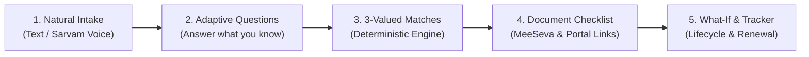

# LabhSaathi (లాభసాథి • लाभसाथी)
### Intelligent Beneficiary Navigation & Claim Readiness Platform

[](https://codebenders-project.potlasrisharanchowdary.workers.dev)
[](https://codebenders-project.potlasrisharanchowdary.workers.dev)
[](https://codebenders-project.potlasrisharanchowdary.workers.dev/matches)
[](#-automated-quality-gates--testing)
[](#-trilingual-accessibility-en--te--hi)
[](#-sensitive-id-shield--rule-0-privacy)

> **"Know your benefits. Understand your rights. Claim what's yours."**  
> **Problem Statement 5:** Citizens and Public Services (*Claim What's Yours*)  
> **Live Web App:** [https://codebenders-project.potlasrisharanchowdary.workers.dev](https://codebenders-project.potlasrisharanchowdary.workers.dev)

---

## 🏛️ Executive Summary

Every year, millions of Indian citizens — especially college students, marginal farmers, rural women, traditional artisans, and informal workers — miss out on published government benefits worth thousands of crores. The reasons are systemic:
- **Language barriers:** Official gazettes and application guidelines are published in bureaucratic English or dense legalese.
- **Form fatigue:** Citizens are forced through 40-question questionnaires before discovering if they qualify for anything.
- **Opaque criteria:** When an application is rejected, nobody explains *which* condition failed or how close the citizen was to qualifying.
- **Predatory middlemen:** Exploitative cyber-cafe agents and unaccredited touts charge ₹500–₹5,000 for government schemes that are legally **100% free**.

**LabhSaathi** solves this through a local-first, privacy-preserving, AI-augmented claim readiness platform. Citizens explain their circumstances in everyday language or speak in their native tongue. Our deterministic 3-valued engine evaluates 219 verified public schemes across all 32 States & UTs, provides clear document checklists from MeeSeva and official portals, simulates hypothetical changes through interactive What-If radar, and protects citizens from middleman exploitation.

---

## 📊 Key Platform Metrics

| Metric | Verified Value | Significance |
|---|---|---|
| **Verified Schemes** | **219 Total** | 109 Central Sector + 110 State Schemes across 32 States & UTs in Cloudflare D1 |
| **Public Benefit Sectors** | **7 Sectors** | Education, Agriculture, Healthcare, Housing, Women & Child, Artisans, Social Security |
| **Deterministic Logic** | **3-Valued Kleene** | True, False, or Unknown (`Likely eligible`, `Need to confirm`, `Unlikely`) — Zero AI hallucinations |
| **PII & Identity Stored** | **0 Numbers** | Sensitive-ID Shield redacts Aadhaar & PAN at boundary. No identity tokens ever persisted |
| **Multilingual Support** | **Trilingual** | Full dynamic interface in English, Telugu (తెలుగు), and Hindi (हिन्दी) |
| **Search Engine** | **SQLite FTS5 + BM25** | Sub-15ms full-text search across titles, criteria, and departmental guidelines |
| **AI Inference** | **Sarvam + Groq** | Regional voice intake + sub-second Llama 3.3 70B grounded Q&A |
| **Verification Coverage** | **120 Tests** | 100% green across 17 test suites, TypeScript strict typecheck, and Playwright e2e |

---

## 🌐 7 Public Benefit Sectors Evaluated

LabhSaathi curates and verifies official gazette schemes across seven statutory citizen sectors:

```
                                  LABHSAATHI CATALOG (219 SCHEMES)
                                                 │
      ┌──────────────────┬──────────────────┬────┴─────────────┬──────────────────┬──────────────────┐
      │                  │                  │                  │                  │                  │
 🎓 Education       🌾 Agriculture     🏥 Healthcare      🏠 Housing         👩 Women & Child   🔨 Artisans & Labor  ⏰ Social Security
  (60+ Schemes)      (35+ Schemes)      (25+ Schemes)      (20+ Schemes)      (30+ Schemes)      (25+ Schemes)        (24+ Schemes)
 • TS ePASS RTF     • PM-KISAN         • PM-JAY (Ayushman) • PMAY-Gramin      • Sukanya Samriddhi • PM Vishwakarma     • Atal Pension
 • AICTE Pragati    • PM Fasal Bima    • PM Suraksha Bima • PMAY-Urban       • Beti Bachao      • PM SVANidhi        • PM-SYM Pension
 • NSP Central      • Rythu Bharosa    • Aarogyasri       • Jal Jeevan       • Matru Vandana    • MGNREGA            • Aasara Pension
 • Saksham PwD      • Kisan Credit Card • Jeevan Jyoti     • PM Ujjwala       • Mahalakshmi      • e-Shram Welfare    • IGNOAPS Old Age
```

1. **Education & Scholarships (60+ Schemes):** Post-matric tuition reimbursements, girl child technical grants, merit-cum-means assistance (e.g. Telangana ePASS RTF, AICTE Pragati, Saksham, NSP Central Sector).
2. **Agriculture & Farmers (35+ Schemes):** Direct income transfers, crop insurance coverage, input subsidies, and institutional credit (e.g. PM-KISAN ₹6,000/yr, PM Fasal Bima, Rythu Bharosa, Kisan Credit Card).
3. **Healthcare & Life Insurance (25+ Schemes):** Cashless secondary and tertiary hospitalization, accidental death cover, and critical care (e.g. Ayushman Bharat PM-JAY ₹5L cover, Aarogyasri, PMSBY, PMJJBY).
4. **Housing & Basic Amenities (20+ Schemes):** Pucca housing construction grants, tap water connections, and clean cooking gas (e.g. PMAY-Gramin, PMAY-Urban, Jal Jeevan Mission, PM Ujjwala).
5. **Women & Child Development (30+ Schemes):** Long-term savings for daughters, conditional maternity cash transfers, free public transit (e.g. Sukanya Samriddhi, Beti Bachao Beti Padhao, PM Matru Vandana, Mahalakshmi).
6. **Artisans, Vendors & Workers (25+ Schemes):** Collateral-free micro-credit, modern toolkit stipends, and guaranteed rural wage employment (e.g. PM Vishwakarma ₹3L credit, PM SVANidhi, MGNREGA).
7. **Social Security & Pensions (24+ Schemes):** Old-age pensions, unorganized sector retirement funds, widow pensions, and benchmark disability stipends (e.g. Atal Pension Yojana, PM Shram Yogi Maandhan, Aasara).

---

## 🤖 AI & Multilingual Architecture

LabhSaathi employs AI strategically where it creates genuine human accessibility, while keeping benefit determinations **100% deterministic**.

```
[ Citizen Input ]
      │
      ├─► [ Regional Voice ] ──► Sarvam AI Speech-to-Text ──► Natural Language Parser ──┐
      │   (Telugu/Hindi/English)                                                        │
      │                                                                                 ▼
      └─► [ Plain Text ] ─────────────────────────────────────────► Sensitive-ID Shield (Rule 0)
                                                                                        │ (Aadhaar/PAN redacted)
                                                                                        ▼
                                                                             Citizen Profile Attributes
                                                                                        │
                                                                                        ▼
                                                                     [ 3-Valued Kleene Rules Engine ]
                                                                                        │ (True / False / Unknown)
                                                                                        ▼
                                                                    4 Fixed Labels: Likely / Need to Confirm / Unlikely
                                                                                        │
                                                                                        ▼
[ Groq LPU (Llama 3.3 70B) ] ◄─── Strict Scheme Context Only ◄─── Discovered Gazette Scheme & MeeSeva Steps
 (Sub-second grounded Q&A)
```

### 1. Sarvam AI Regional Voice Intake
Designed specifically for rural and semi-literate citizens. Instead of wrestling with a 40-field form:
- Citizens tap the microphone and speak naturally in **Telugu**, **Hindi**, or **English**.
- The audio is processed via Sarvam AI's multilingual speech recognition API.
- The returned transcript is parsed to extract profile parameters (e.g. caste category, landholding size, family income, education level).

### 2. Groq LPU Grounded Scheme Assistant
- Powered by `llama-3.3-70b-versatile` running on Groq LPUs for sub-second responses.
- **Strict Grounding:** The assistant is supplied *only* with the verified gazette rules, required MeeSeva documents, and official submission steps for that specific scheme.
- Zero AI hallucinations: the assistant cannot invent unlisted rules, false deadlines, or fake fees.

### 3. Trilingual Accessibility (EN • TE • HI)
Every UI element, button, question, document requirement, and navigation link is fully translated across:
- **English (`en`)**
- **Telugu (`te` — తెలుగు)**
- **Hindi (`hi` — हिन्दी)**

Language preference is persisted in client storage (`localStorage`) and immediately sets `document.documentElement.lang`.

---

## 🛡️ Sensitive-ID Shield & Rule 0 Privacy

LabhSaathi operates under strict civic privacy principles:
- **Zero Identity Ingestion:** We **never** collect, transmit, or store Aadhaar numbers, PAN cards, voter IDs, bank account numbers, or passwords.
- **Client & Backend Boundary Inspection:** Active regex filters inspect all user input and immediately redact 12-digit UIDAI sequences and 10-character PAN patterns with helpful guidance notices.
- **Local-First Evaluation:** Citizen profile attributes live in the citizen's browser session. Swapping backends or running offline leaves personal data safely on the citizen's device.

---

## 🚀 5-Step Connected User Journey



1. **Natural Intake (`/intake`):** Citizen enters details in plain language, speaks via voice modal, or selects one of 6 pre-verified synthetic personas (Priya, Rajesh, Ramesh, Lakshmi, Koteshwar, Ananya).
2. **Adaptive Questionnaire:** Missing attributes gracefully map to `null` (Unknown). Citizens only answer relevant follow-ups without forced drop-down mazes.
3. **3-Valued Matches (`/matches`):** 219 schemes evaluated using Kleene 3-valued logic:
   - **Likely eligible:** All conditions evaluate to `true`.
   - **Need to confirm:** Key conditions are `unknown`. Missing fields are surfaced clearly.
   - **Unlikely:** At least one mandatory condition evaluates to `false`.
   - **Near-Match Discovery:** When exactly 1 condition fails (e.g. attendance 70% vs required 75%), actionable delta advice is provided.
4. **Document Checklist & Middleman Shield (`/scheme/:id`, `/checklist`):** Sourced list of revenue documents (Income Certificate, Caste Certificate, Land RoR) with issuing authorities, official portal URLs, and bold warnings that **official submission is 100% free**.
5. **What-If Simulation Radar & Tracker (`/tracker`):** Interactive sliders let citizens test hypothetical income or attendance changes without modifying their saved profile. Claim stages (`Preparing` → `Ready` → `Applied` → `Verifying` → `Disbursed`) keep citizens on track across academic renewal cycles.

---

## 💻 Tech Stack & Engineering Standards

- **Frontend:** React 19, TypeScript 5.7, Vite 6, Tailwind CSS 4, Lucide Icons, React Router 7.
- **Backend / Edge:** Cloudflare Workers, Hono 4, Node.js compatibility mode.
- **Database & Search:** Cloudflare D1 (SQLite) with **FTS5 full-text indexing** and BM25 relevance ranking.
- **AI Integrations:** Sarvam AI (Regional Speech-to-Text) + Groq Cloud (Llama 3.3 70B Versatile).
- **Testing:** Vitest 3, React Testing Library, Playwright (Chromium multi-viewport automation).
- **Architecture:** Clean Architecture (`src/core/` domain knows nothing about React or cloud storage; presentation binds via Riverpod-style hooks).

---

## ⚡ Quick Start & Local Development

### Prerequisites
- Node.js 20+
- npm 10+
- (Optional) Cloudflare Wrangler CLI for edge deployment

### 1. Clone & Install
```bash
git clone https://github.com/potlasrisharan/labhsaathi.git
cd labhsaathi
npm install
```

### 2. Run Local Development Server
```bash
# Starts Vite dev server with client and backend routes
npm run dev
```
Open [http://localhost:5173](http://localhost:5173) in your browser.

### 3. Production Build
```bash
npm run build
```
Compiles TypeScript with zero emit errors and bundles static assets into `dist/`.

### 4. Preview Production Build
```bash
npm run preview -- --port 4173 --strictPort
```

---

## 🧪 Automated Quality Gates & Testing

LabhSaathi maintains rigorous testing standards:

```bash
# 1. Typecheck: strict TypeScript compiler verification (0 errors)
npm run typecheck

# 2. Lint: ESLint code style and hook rules check (0 errors, 0 warnings)
npm run lint

# 3. Unit & Integration Tests: 120 tests across 17 test files
npm test

# 4. Structure & Invariant Test: validates Clean Architecture and Rule 0
npx vitest run tests/structure.test.ts

# 5. Playwright End-to-End Test: desktop, tablet, and mobile journeys
npm run test:e2e

# 6. Real Production Website Verification: runs against live Cloudflare Worker
node scripts/test-real-website.mjs
```

### Test Suite Breakdown (120 Tests)
- `tests/structure.test.ts` — Architectural layout, route exports, 32-state coverage registry, and Rule 0 git hygiene.
- `tests/d1-search.test.ts` — FTS5 full-text search, BM25 ranking, limit/offset pagination, and state filters.
- `tests/integration/api-backend.test.ts` — Hono `/api/v1` endpoints, CORS headers, and error states.
- `tests/unit/eligibility-engine.test.ts` — Deterministic Kleene 3-valued truth tables.
- `tests/voice-intake.test.ts` — Telugu & English entity extraction from speech transcripts.
- `tests/groq-chat.test.ts` — Grounded scheme prompts and hallucination barriers.
- `tests/unit/sensitive-id-shield.test.ts` — Aadhaar (Verhoeff) & PAN format masking.
- `tests/unit/what-if-service.test.ts` — Delta simulation across income and academic thresholds.
- `tests/unit/unified-action-graph.test.tsx` — Interactive flowchart visualizer rendering.
- `tests/unit/routes.test.tsx` — Client routing and accessible heading hierarchy.

---

## 📡 Live Production Endpoints

The live reference implementation is deployed at:  
👉 **`https://codebenders-project.potlasrisharanchowdary.workers.dev`**

| Method | Endpoint | Description |
|---|---|---|
| `GET` | `/api/v1/health` | Edge service health status and timestamp |
| `GET` | `/api/v1/schemes?limit=20` | Paginated catalog of all 219 verified schemes |
| `GET` | `/api/v1/schemes/search?q=kisan` | Cloudflare D1 FTS5 full-text search ranked by BM25 |
| `GET` | `/api/v1/schemes/search?q=scholarship&state=Telangana` | Jurisdictional and categorical filtered search |
| `GET` | `/api/v1/schemes/:id` | Full scheme record with rules, documents, and application steps |
| `POST`| `/api/v1/voice/transcribe` | Sarvam AI multilingual voice intake proxy |
| `POST`| `/api/v1/chat/completions` | Groq Llama 3.3 70B grounded Q&A endpoint |

---

## ⚖️ Civic Disclaimer & Transparency Notice

LabhSaathi is an independent civic-technology initiative built for **Problem Statement 5 (ACE BUILDERS 2026)**.
- LabhSaathi is **not** an official government agency and does not issue legal determinations.
- Submitting an application for any scheme must always be completed directly through the competent official departmental portal (e.g. Telangana ePASS, National Scholarship Portal, PM-KISAN Portal).
- All government scholarship applications are **100% free** of official submission fees. Citizens should **never** pay money to private agents or intermediaries promising guaranteed approvals.
